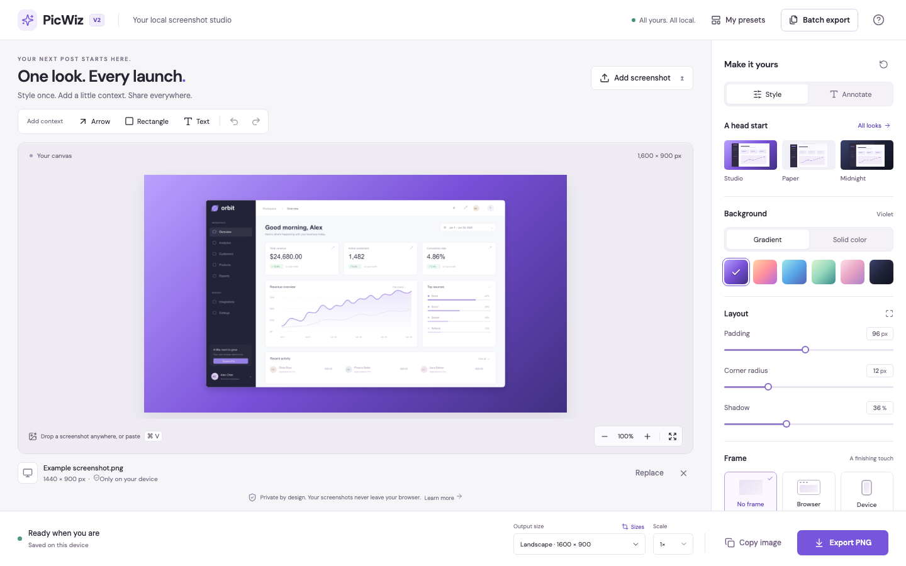
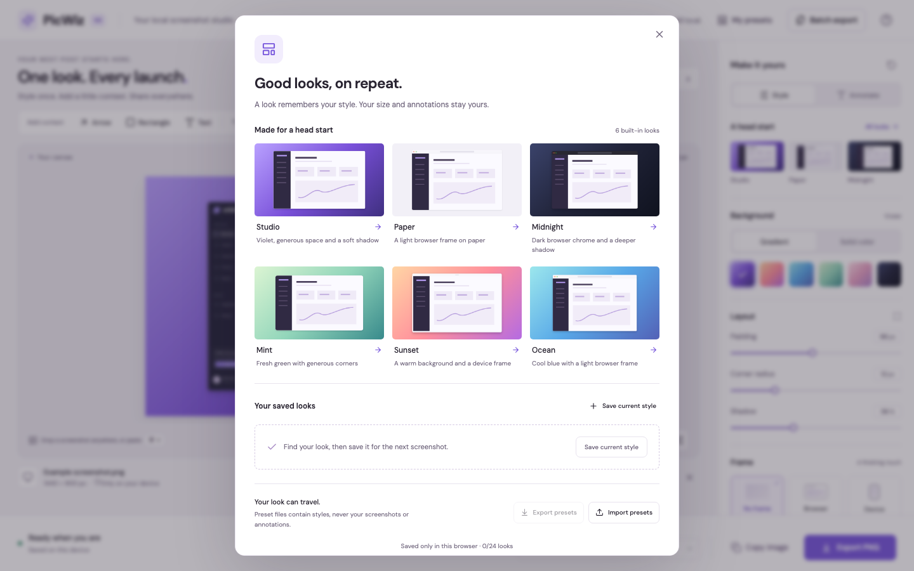
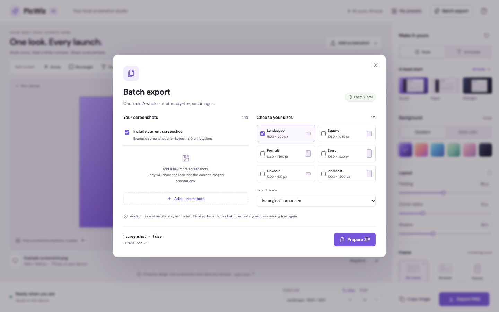
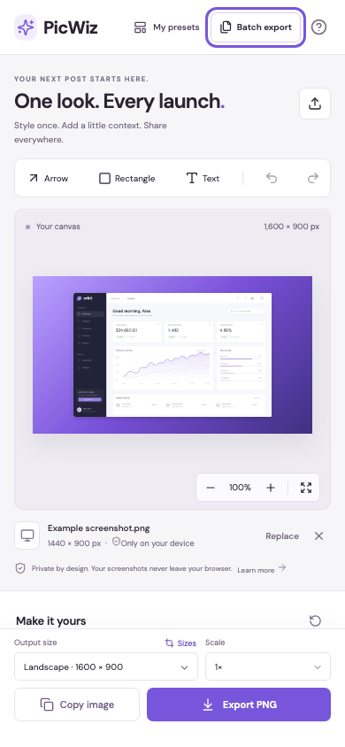

<p align="center">
  
</p>

<h1 align="center">PicWiz</h1>

<p align="center">Turn screenshots into polished social images. Keep every pixel on your device.</p>

<p align="center">
  <a href="https://github.com/macopc/PicWiz/actions/workflows/ci.yml"></a>
  <a href="LICENSE"></a>
  <a href="https://nodejs.org/en/download"></a>
</p>

<p align="center">
  English · <a href="README.zh-CN.md">简体中文</a> · <a href="docs/guides/usage.md">Usage guide</a> · <a href="docs/README.md">Documentation & specs</a> · <a href="CONTRIBUTING.md">Contribute</a>
</p>



PicWiz is a focused screenshot studio for product launches, changelogs and social posts. Drop a screenshot, choose a look, add a little context, and export. Reuse that look across your next post or a whole batch.

**Screenshots stay in your browser.** Rendering, annotations, preset files and ZIP creation run locally. V2 has no accounts, uploads, analytics, database or cloud storage. Your browser profile and origin own the workspace; people sharing that profile share its data.

## Quick start

Install [Node.js 24 LTS](https://nodejs.org/en/download) and Git, then run:

```sh
git clone https://github.com/macopc/PicWiz.git
cd PicWiz
npm ci
npm run dev
```

Open **[localhost:3000](http://localhost:3000)**. No account, API key, environment file or database setup is needed. The example screenshot and fonts are bundled.

1. Try the example that loads on first visit, click **Add screenshot**, or drop/paste a PNG, JPEG or WebP. On an empty canvas, **Use example** brings the demo back.
2. Pick a starter look. Adjust the background, padding, corners, shadow or frame.
3. Choose an output size and scale, then **Export PNG** or **Copy image**.

For a consistent feed, open **My presets**, save the current appearance, then apply it to your next screenshot. The [usage guide](docs/guides/usage.md) walks through presets, annotations and batch export.

## What you can make

| Capability | Available in V2 |
| --- | --- |
| Style presets | Six starter looks and up to 24 personal presets; rename, update, delete and share appearance-only JSON. |
| Screenshot styling | Gradient or solid backgrounds, padding, rounded corners, shadow, and light/dark browser or device frames. |
| Annotations | Arrows, rectangles and text; layer selection, keyboard positioning, and session undo/redo. |
| Social sizes | Six formats with exact PNG dimensions at 1× or 2×. |
| Batch export | Up to 10 screenshots × 3 sizes in one local ZIP, with progress, cancellation and partial-failure recovery. |
| Local persistence | Restore the current screenshot, style, annotations and saved presets after refresh. |

| Format | Pixels at 1× | Format | Pixels at 1× |
| --- | --- | --- | --- |
| Landscape | 1600 × 900 | Square | 1080 × 1080 |
| Portrait | 1080 × 1350 | Story | 1080 × 1920 |
| LinkedIn | 1200 × 627 | Pinterest | 1000 × 1500 |

LinkedIn refers to a Page link image; Pinterest refers to a standard image ad. These are composition presets, not guarantees about platform acceptance or cropping.

<details>
<summary><strong>See presets, batch export and the mobile layout</strong></summary>

### A reusable look library



### One look, multiple outputs



### A workspace for smaller screens



Screenshots show the real V2 interface with fictional demo content. [Screenshot provenance and update instructions](docs/guides/screenshots.md).

</details>

## Develop and test

```sh
npm ci
npx playwright install --with-deps chromium firefox webkit
npm test
```

`npm test` runs TypeScript checks, unit/adapter tests and browser journeys. Chromium runs the full suite; Firefox and WebKit run critical journeys. Tests use isolated browser storage. Leave port 3000 free for the automatically started development server, or supply `PLAYWRIGHT_BASE_URL` for an existing server.

The [V2 validation record](docs/v2/validation.md) documents the completed production run: **110 unit/adapter tests and 57 browser cases**, including exported pixels, ZIP contents, migration, recovery and interaction races. It also states what was not proven on physical devices or the OS clipboard.

| Command | Purpose |
| --- | --- |
| `npm run dev` | Start the local editor. |
| `npm run build` / `npm start` | Build / serve the production app. |
| `npm run typecheck` | Check TypeScript. |
| `npm run test:unit` / `npm run test:e2e` | Run one test layer. |
| `npm run docs:check` | Check repository documentation links and image references. |
| `npm run seed` | Regenerate fictional demo and recovery fixtures; does not change browser data. |

See the [development guide](docs/guides/development.md) for the code map, production testing and troubleshooting. Built with **Next.js App Router, React, TypeScript and browser Canvas**. No backend services are required for V2.

## Local retention, backup and recovery

The current workspace and presets live in `localStorage`. Only one screenshot is durable; annotation undo and batch files/results last for the current session. Clearing browser data or changing the site's origin can make the workspace unavailable. Keep a private backup before upgrading or resetting.

The editor offers recovery for storage errors, session-only editing/export, a local backup download and confirmed **Clear local data**. Backup files may contain your screenshot. The retained `shinyshot:store` key is a V1 rollback backup; normal work uses `picwiz:store`. There is no full-backup import screen or cloud recovery.

Read [local data, migration and manual restore](docs/guides/local-data.md) before restoring or rolling back. [Deployment and diagnostics](docs/guides/deployment.md) covers HTTPS, headers, health checks and hosting.

## Limits worth knowing

- **Input:** PNG/JPEG/WebP, up to 25 MiB, 40 megapixels and 16,384 pixels per edge. Saved images are normalized to at most 4096 pixels per edge and may be compressed or reduced further. A 2× export cannot restore lost source detail.
- **Batch:** 10 sources, 150 MiB original inputs, 30 PNGs, 64 MiB retained PNGs and a 65 MiB ZIP. These are retained-output limits, not a total browser-memory guarantee. Closing the batch dialog discards its results.
- **Browser APIs:** editing needs JavaScript and Canvas. Clipboard copying requires browser support, HTTPS/localhost and permission; PNG download is the fallback. No offline service worker is included.
- **Annotations:** up to 30 objects; text is limited to 140 characters and three rendered lines. Annotations are not a redaction tool.
- **Native encoding:** cancellation stops new work, but cannot forcibly end a browser encoder. A hung native callback may require reload. See [recovery guidance](docs/guides/usage.md).

## Project status and roadmap

**V2 is implemented. V3 is specified, not implemented.** The repository includes the research, product designs, engineering contracts and independent review records that led to both stages.

| Stage | Scope | Status |
| --- | --- | --- |
| V2 | Presets, batch PNG export, annotations, social sizes | Implemented and locally validated. [Specification](docs/v2/spec.md) · [Evidence](docs/v2/validation.md) |
| V3 Gallery | Headless CMS template library; Sanity selected in the specification | Specification reviewed; no integration yet. [Gallery spec](docs/v3/gallery-spec.md) |
| V3 3D | Three.js procedural generic models | Independent PNG POC planned; GPU/device evidence pending. [POC spec](docs/v3/render-poc-spec.md) |
| V3 Video | Browser encoding with device capability probes | POC planned; codec, memory and actual playback gates pending. [POC spec](docs/v3/render-poc-spec.md) |
| V3 Accounts | Clerk hosted SDK; explicitly selected appearance data only | Specification reviewed; no account or sync implementation. [Account spec](docs/v3/accounts-spec.md) |

Start with the [documentation index](docs/README.md) for the source-of-truth order, [V3 implementation specification](docs/v3/spec.md), and the distinction between reviewed requirements and completed tests. Most product research and V3 specifications are written in Chinese.

## Contribute

Bug reports, focused fixes, accessibility improvements and documentation contributions are welcome. Read [CONTRIBUTING.md](CONTRIBUTING.md), use a [bug or feature form](https://github.com/macopc/PicWiz/issues/new/choose), and attach only fictional or sanitized examples. Discuss scope before starting a substantial V3 change.

[Support](SUPPORT.md) · [Security reporting](SECURITY.md) · [Code of conduct](CODE_OF_CONDUCT.md) · [Changelog](CHANGELOG.md)

## License and credits

[MIT](LICENSE) © 2026 macopc and PicWiz contributors. Bundled fonts, icons and dependencies retain their own licenses; see [third-party notices](THIRD_PARTY_NOTICES.md).
